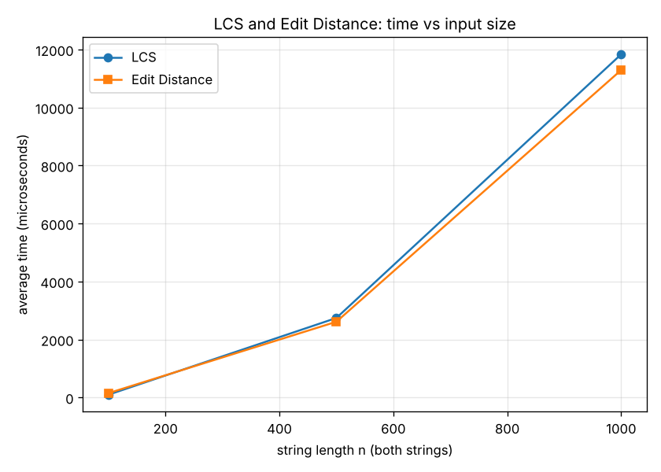
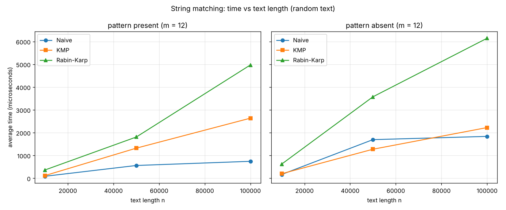
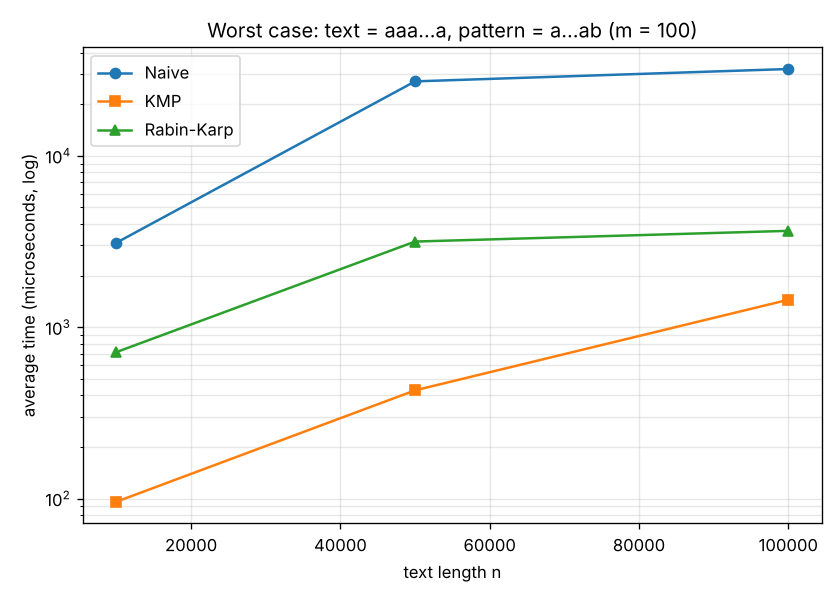
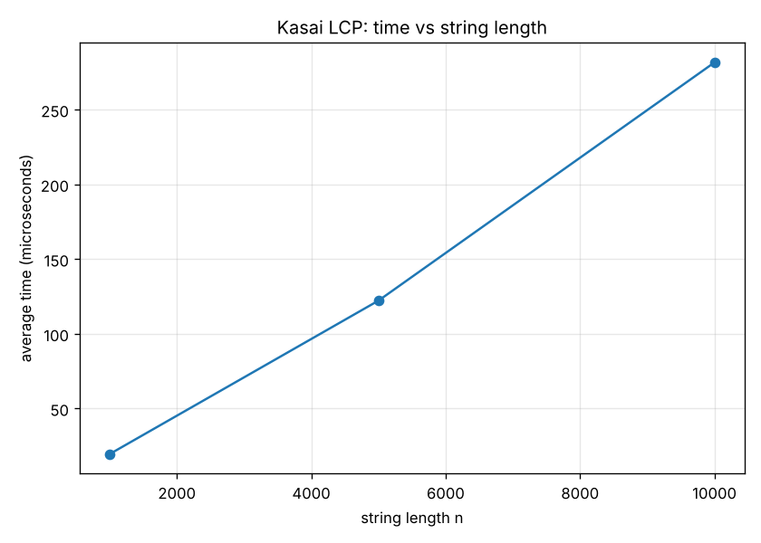

# Assignment 4 - Text Analysis: Dynamic Programming and String Algorithms

**Student:** Azimbek Amandykov  
**Group:** SE-2539

## 1. Problem description and algorithm overview

In this assignment I made a small Java program for text analysis. It has three parts.

**Part A. Dynamic programming.** Here we compare two strings.

- LCS (Longest Common Subsequence) is the length of the longest sequence of letters that is in both strings in the same order. The letters don't have to be next to each other. For example, LCS("ABCBDAB", "BDCABA") = 4, one answer is "BCBA".
- Edit Distance (Levenshtein) is the smallest number of insertions, deletions and substitutions to turn one string into another. For example, "kitten" -> "sitting" = 3.

**Part B. String matching.** We have a text T (length n) and a pattern P (length m), and we need all positions where P starts in T.

- Naive: try every position and compare letter by letter. This is the baseline.
- KMP: first build the LPS table for the pattern, then search without ever going back in the text.
- Rabin-Karp: compare hashes of windows instead of letters. Letters are checked only when the hashes are equal.

**Part C. Kasai's algorithm.** We get a string and its suffix array, and build the LCP array in linear time.

## Project structure

```
assignment-4/
├── src/
│   ├── dp/          LCS, EditDistance
│   ├── matching/    NaiveMatcher, KMP, RabinKarp, MatchResult
│   ├── suffix/      SuffixArray (simple helper), Kasai
│   ├── util/        StringGenerator (random strings with fixed seed)
│   └── app/         Main (demo), Tests, Benchmark
├── results/
│   ├── tables/      results.md, results.csv
│   └── plots/       png plots
├── plot.py
└── README.md
```

## How to run

You need Java 17 or newer. I ran everything from IntelliJ IDEA.

**IntelliJ (easiest):**

1. Open the project folder. If the `src` folder is not blue, right click on it -> Mark Directory as -> Sources Root.
2. Run `app.Main` with the green arrow. This runs the demo.
3. To run tests or experiments: Run -> Edit Configurations -> Program arguments, write `test` or `bench` and run again.

**Terminal:**

```bash
javac -d out $(find src -name "*.java")
java -cp out app.Main          # demo
java -cp out app.Main test     # tests
java -cp out app.Main bench    # experiments, writes results/tables
python3 plot.py                # plots in results/plots (needs matplotlib)
```

On Windows PowerShell the first command is:

```powershell
javac -d out (Get-ChildItem -Recurse src -Filter *.java).FullName
```

If PowerShell says `javac` is not recognized, it means Java is not in PATH. Then just run it from IntelliJ, or add the `bin` folder of your JDK to PATH (IntelliJ keeps its JDKs in `C:\Users\<name>\.jdks\`).

## 2. Implementation decisions and assumptions

### LCS (`dp/LCS.java`)

`dp[i][j]` is the LCS length for the first `i` letters of `a` and the first `j` letters of `b`.

- Base case: `dp[0][j] = 0` and `dp[i][0] = 0`, because with an empty string there is nothing in common. In Java a new `int` array is already filled with zeros, so I didn't write a separate loop.
- If `a[i-1] == b[j-1]`: `dp[i][j] = dp[i-1][j-1] + 1`
- Otherwise: `dp[i][j] = max(dp[i-1][j], dp[i][j-1])`
- The answer is `dp[n][m]`.

I also added `sequence()`. It goes back through the table and builds one LCS string. It was not required, but it helped me check that the table is correct.

Why this works: look at the last letters of the two prefixes. If they are the same, we can put this letter at the end of the common subsequence, and it is never worse than not taking it, so the answer is 1 + LCS of the shorter prefixes. If they are different, then at least one of these two letters is not in the LCS, so we remove one of them and take the better result. Each cell only uses the cell above, the cell on the left and the diagonal one, and they are already filled when we go row by row.

### Edit Distance (`dp/EditDistance.java`)

`dp[i][j]` is the minimum number of operations to turn the first `i` letters of `a` into the first `j` letters of `b`.

- Base case: `dp[i][0] = i` (delete all `i` letters) and `dp[0][j] = j` (insert all `j` letters).
- `cost = 0` if `a[i-1] == b[j-1]`, else `cost = 1`.
- `dp[i][j] = min(dp[i-1][j] + 1, dp[i][j-1] + 1, dp[i-1][j-1] + cost)`. The three options are delete, insert and substitute (or keep, if the letters are equal).

Why this works: in the best solution, the last letter of `a[0..i)` can only end up in one of three ways. It is deleted, or we insert `b[j-1]` after it, or it becomes `b[j-1]` (for free if they are equal, or with one substitution). There are no other options, and every option leaves a smaller problem that is already in the table. So the minimum of the three is the answer.

### Naive matching (`matching/NaiveMatcher.java`)

For every `i` from `0` to `n - m` I compare `T[i + j]` with `P[j]` until the first mismatch. If all `m` letters match, I add `i` to the list.

### KMP (`matching/KMP.java`)

I wrote it like the two short functions from the practice lecture.

`computeLPS` builds the table. `lps[i]` is the length of the longest proper prefix of `P[0..i]` that is also its suffix (the "border"). Example from the lecture: `AAACAAAA -> [0,1,2,0,1,2,3,3]`. `len` is the length of the current border:

- if `p[i] == p[len]`, the border grows: `lps[i++] = ++len`
- if they are different and `len > 0`, we fall back: `len = lps[len - 1]` (and `i` stays the same)
- if they are different and `len == 0`, there is nothing to reuse: `lps[i++] = 0`

`kmpSearch` does the search. `i` moves through the text, `j` is how many letters of the pattern are matched now. There are three cases:

- letters are equal: `i++`, `j++`
- `j == m`: we found the pattern at `i - j`, then `j = lps[j - 1]`. Because of this, overlapping matches are also found ("aa" in "aaaaa" gives 0, 1, 2, 3).
- letters are different: `j = lps[j - 1]` if `j > 0`, otherwise `i++`.

How KMP avoids repeated comparisons: when a mismatch happens after `j` matched letters, we already know the last `j` letters of the text, because they are equal to `P[0..j)`. `lps[j-1]` tells us how long a part of the pattern is already matched at the end of them. So we continue from there and don't go back in the text. `i` never decreases, so the search is linear. In the worst case test I got 199,999 comparisons for n = 100,000, which is about 2n.

One thing about this loop form: the same pair of letters can be compared twice (in the first `if` and again in the mismatch check). I count both, so in my tables KMP has about 2n comparisons. It is still O(n).

### Rabin-Karp (`matching/RabinKarp.java`)

I used the version with prefix hashes from the practice lecture.

The hash is `H(s) = (code(s0)*p^0 + code(s1)*p^1 + ... + code(s(m-1))*p^(m-1)) mod M`, where `code(c) = c - 'a' + 1`, `p = 31` and `M = 1,000,000,009`.

`code` starts from 1, not from 0. If 'a' was 0, then "a", "aa" and "aaa" would all have hash 0. Because of this formula the letters must be lowercase a-z. My method checks this and throws an exception for other characters.

Steps:

1. `pPow[]`: powers of p, computed once.
2. `h[]`: prefix hashes of the text, `h[i+1] = (h[i] + code(T[i]) * pPow[i]) mod M`. So `h[k]` is the hash of the first k letters.
3. `patternHash`: hash of the pattern, the same way.
4. For each window `T[i..i+m)`: `cur = (h[i+m] - h[i] + M) mod M`. This is the window hash, but multiplied by `p^i`, so I compare it with `patternHash * pPow[i] mod M`. It's one comparison per window. The `+ M` is needed because after subtraction the number can be negative, and then equal hashes would look different.

How collisions are handled: two different strings can have the same hash. So when the hashes are equal, I always check the letters one by one. If they match, I save the position. If not, it's a "spurious hit", I count it and continue. So a collision can only make it slower, it can't give a wrong answer. To test this I ran it with a tiny modulus `M = 7`. There were 730 spurious hits, and the result was still the same as Naive. I check the letters with my own loop and not with `String.startsWith`, because the assignment says not to replace the algorithms with library methods.

Prefix hashes need O(n) extra memory for `h[]` and `pPow[]`. A version with one sliding hash would use O(1) memory, but the prefix version is easier to read and can give the hash of any substring in O(1).

### Kasai (`suffix/Kasai.java`) and the suffix array

The suffix array is built by `SuffixArray.build`. It's just a simple helper: it sorts the start positions of suffixes with a comparator that compares letters. The assignment says we don't have to write a fast suffix array algorithm. I build it before the timer starts, so only Kasai is measured. For small strings I checked it by hand: `banana` gives `[5,3,1,0,4,2]` and `banana$` gives `[6,5,3,1,0,4,2]`, like in the lecture.

What LCP means: `lcp[i]` is the length of the longest common prefix of suffix `sa[i]` and the suffix before it in sorted order, `sa[i-1]`. `lcp[0] = 0` because there is nothing before it. With the LCP array you can find, for example, the longest repeated substring (`max(lcp)`) and the number of different substrings (`n(n+1)/2 - sum of lcp`).

Kasai's algorithm (`buildLCP`, same name as in the lecture):

1. `rank[sa[i]] = i`, the position of every suffix in the sorted order.
2. Go through suffixes in text order, `i = 0..n-1`. Compare suffix `i` with the suffix before it in the SA, `j = sa[rank[i] - 1]`. Start from the current `k` and increase `k` while the letters match. Save `lcp[rank[i]] = k`.
3. Then `k--`.

Why we can start from `k - 1`: if suffix `i` has `k` common letters with its neighbour, then suffix `i+1` is the same suffix without the first letter, so it has at least `k - 1` common letters with its own neighbour.

Manual check for `banana`:

| i | sa[i] | suffix | lcp[i] |
|---|---|---|---|
| 0 | 5 | a | 0 |
| 1 | 3 | ana | 1 ("a") |
| 2 | 1 | anana | 3 ("ana") |
| 3 | 0 | banana | 0 |
| 4 | 4 | na | 0 |
| 5 | 2 | nana | 2 ("na") |

So `LCP = [0, 1, 3, 0, 0, 2]`, and the test checks exactly this.

### Assumptions

- Empty pattern: all three algorithms return an empty list. You could say the empty string is at every position, but for text search that is not useful, so I treat it as "nothing to search". It works the same way in all three.
- Pattern longer than the text: empty list. Empty text: empty list.
- Overlapping matches are counted ("aa" in "aaaa" gives 0, 1, 2).
- Letters are compared as Java `char`, so upper and lower case are different.
- Rabin-Karp only works with lowercase a-z because of `c - 'a' + 1` (like in the lecture). Naive and KMP work with any characters.
- Alphabet for the experiments: `{a, b, c, d}` (`StringGenerator.ALPHABET`). I chose a small alphabet so there are more partial matches and the difference between the algorithms is easier to see.
- Kasai needs `sa.length == s.length()`, otherwise it throws an exception.

## 3. Complexity analysis

n is the text length (or the first string), m is the pattern length (or the second string).

| Algorithm | Main operation / recurrence | Best case | Worst case | Extra space | Why |
|---|---|---|---|---|---|
| LCS | `dp[i][j] = dp[i-1][j-1]+1` if equal, else `max(dp[i-1][j], dp[i][j-1])` | Θ(n·m) | Θ(n·m) | Θ(n·m) | every one of the n·m cells is filled once in O(1); I keep the whole table to rebuild the sequence |
| Edit Distance | `dp[i][j] = min(del+1, ins+1, sub+cost)`, `dp[i][0]=i`, `dp[0][j]=j` | Θ(n·m) | Θ(n·m) | Θ(n·m) | same table, every cell is O(1) |
| Naive | compare `T[i+j]` with `P[j]` for every shift `i` | Θ(n) | Θ((n−m+1)·m) | O(1) | best: the first letter is different at every shift; worst: almost the whole pattern matches at every shift (`aaa…a` and `aa…ab`) |
| KMP | build LPS, then search with `j = lps[j-1]` on mismatch | Θ(n + m) | Θ(n + m) | Θ(m) | LPS takes O(m); in the search `i` never goes back and `j` can't fall back more than it went forward, so the steps are linear |
| Rabin-Karp | window hash `cur = h[i+m] − h[i]`, compare with `patternHash·p^i`, check letters if equal | Θ(n + m) | O(n·m) | Θ(n) | preprocessing O(n + m) for `pPow[]`, `h[]` and the pattern hash; every window hash is O(1). Expected O(n+m) because collisions are rare with a big prime M. Worst case O(n·m) if many windows have equal hashes (many collisions or many real matches), because each one needs an O(m) check |
| Kasai | `k` starts from the previous `k − 1` and grows while letters match | Θ(n) | Θ(n) | Θ(n) | `k` grows at most about n times in total and drops by 1 per step, so there are at most about 2n matches and n mismatches; `rank` and `lcp` are n each |
| SA helper (not measured) | sort suffixes with a letter comparator | O(n log n) | O(n² log n) | O(n) | only used to prepare input for Kasai |

**Preprocessing and search for string matching:**

| Algorithm | Preprocessing | Search | Total | Extra memory |
|---|---|---|---|---|
| Naive | none | O((n−m+1)·m) worst, about O(n) on random text | O(n·m) | O(1) |
| KMP | `computeLPS`: Θ(m) | Θ(n) | Θ(n + m) | Θ(m) for `lps` |
| Rabin-Karp | `pPow[]`, `h[]`, pattern hash: Θ(n + m) | O(1) per window, so Θ(n) expected and O(n·m) worst | O(n + m) expected | Θ(n) for `pPow` and `h` |

**Expected vs worst case.** Only Rabin-Karp has a different expected and worst case. It depends on how often the hashes collide. With M around 10^9 the chance of a collision for one window is about 1/M, and in all my experiments there were 0 spurious hits, so in practice it was linear. Naive has a different best and worst case depending on the input: on random text it's almost linear, but on repeating text it's O(n·m). KMP and Kasai are linear in every case.

**Theory vs measured time.** The tables above are about operation counts and how they grow. The real time (section 6) also depends on things that Big-O ignores: constant factors (like `%` in Rabin-Karp), the JIT compiler, CPU cache and garbage collection. That's why I show both time and operation counts.

## 4. Testing strategy and results

The tests are in `src/app/Tests.java` (`java -cp out app.Main test`). I wrote a small `check()` method instead of using JUnit, so the project compiles with plain `javac` and doesn't need any libraries.

Result: 43 passed, 0 failed.

| What | Cases |
|---|---|
| LCS | identical strings (= length), completely different strings (0), empty first / second / both strings (0), two textbook examples (4 and 4), rebuilt sequence is "GTAB" |
| Edit Distance | identical (0), one empty string (3 insertions / 3 deletions), only substitution (cat -> cut = 1), only insertion (cat -> cart = 1), only deletion (cart -> cat = 1), kitten -> sitting = 3, sunday -> saturday = 3, intention -> execution = 5 |
| String matching | pattern at the beginning, middle, end; several matches; overlapping matches; pattern not in text; pattern longer than text; empty pattern; empty text; pattern equal to text; lecture example (match at 10); LPS tables |
| Same answer | every matching test checks that Naive, KMP and Rabin-Karp return the same list. Also 50 random texts with random patterns |
| Collisions | Rabin-Karp with modulus 7: there are collisions (730 spurious hits), but the answer is still correct; letters outside a-z are rejected |
| Kasai | `banana`: SA `[5,3,1,0,4,2]`, LCP `[0,1,3,0,0,2]` (checked by hand above); `banana$`: same SA and LCP as in the lecture; `aaaa`: `[0,1,2,3]`; one letter; empty string; 20 random strings compared with a brute force LCP; comparisons ≤ 3n |

The demo (`java -cp out app.Main`) prints examples for all algorithms, including the `banana` table.

## 5. Experimental setup

| Experiment | Sizes | Input |
|---|---|---|
| LCS | n = m = 100, 500, 1000 | two random strings, seed `42 + n` |
| Edit Distance | n = m = 100, 500, 1000 | the same two strings as for LCS |
| String matching | n = 10,000, 50,000, 100,000 | random text, seed 42, pattern length m = 12 |
| Matching worst case (extra) | n = 10,000, 50,000, 100,000 | text `aaa…a`, pattern 99 times `a` + `b` (m = 100) |
| Kasai | n = 1000, 5000, 10,000 | random string, seed `142 + n` |

- Alphabet is `{a, b, c, d}`. I use `java.util.Random` with a fixed seed, so every run gets the same inputs.
- The "present" pattern is a substring of the text from position `n/2`, so it is there at least once.
- The "absent" pattern is a random string of length 12 from the same alphabet. I generate it again until I check that it's not in the text.
- Naive, KMP and Rabin-Karp get the same text and the same pattern. The benchmark also checks that all three found the same positions.

How I measured time (`app/Benchmark.java`):

1. All inputs are generated before the timer. The suffix array for Kasai is also built before.
2. Warm-up: before measuring, each call runs for at least 300 ms (and at least 30 times), so the JIT compiler can optimize the code. Without warm-up the small sizes were measured several times slower than they really are.
3. Then 5 runs with `System.nanoTime()`. The tables show the average in microseconds.
4. Nothing is printed or written to files inside the timed part. Files are written only at the end.
5. Operation counts are taken from one more run. They are always the same because the algorithms are deterministic.

What I count:

- DP: filled cells and letter comparisons.
- Matching: letter comparisons (Naive, KMP, and Rabin-Karp when it checks), hash comparisons and spurious hits (Rabin-Karp).
- Kasai: letter comparisons.

My laptop: HP 255 G8, AMD Ryzen 5 3500U (2.1 GHz), 8 GB RAM, Windows 10 Pro, run from IntelliJ IDEA. Other programs were open while it was running, so the times have some noise. The operation counts are exact and don't depend on the computer.

## 6. Results

All tables are also saved in `results/tables/results.md` and `results/tables/results.csv`.

### LCS and Edit Distance

| n = m | LCS avg time (µs) | LCS length | Edit avg time (µs) | Edit distance | cells filled | char comparisons |
|---|---|---|---|---|---|---|
| 100 | 95.46 | 61 | 149.70 | 56 | 10,000 | 10,000 |
| 500 | 2740.78 | 320 | 2610.32 | 262 | 250,000 | 250,000 |
| 1000 | 11834.98 | 647 | 11292.50 | 524 | 1,000,000 | 1,000,000 |



### String matching, pattern present (m = 12)

| n | Naive (µs) | KMP (µs) | Rabin-Karp (µs) | Naive char cmp | KMP char cmp | RK hash cmp | RK char cmp | RK spurious | matches |
|---|---|---|---|---|---|---|---|---|---|
| 10,000 | 87.78 | 118.50 | 364.28 | 13,437 | 20,012 | 9,989 | 12 | 0 | 1 |
| 50,000 | 561.12 | 1321.60 | 1810.34 | 66,621 | 99,998 | 49,989 | 12 | 0 | 1 |
| 100,000 | 743.92 | 2637.30 | 4973.86 | 133,409 | 210,177 | 99,989 | 12 | 0 | 1 |

### String matching, pattern absent (m = 12)

| n | Naive (µs) | KMP (µs) | Rabin-Karp (µs) | Naive char cmp | KMP char cmp | RK hash cmp | RK char cmp | RK spurious | matches |
|---|---|---|---|---|---|---|---|---|---|
| 10,000 | 166.18 | 199.16 | 621.20 | 13,387 | 19,999 | 9,989 | 0 | 0 | 0 |
| 50,000 | 1695.52 | 1274.16 | 3575.94 | 66,637 | 100,038 | 49,989 | 0 | 0 | 0 |
| 100,000 | 1837.96 | 2224.42 | 6144.88 | 132,845 | 200,076 | 99,989 | 0 | 0 | 0 |



### Extra: worst case for Naive (text `aaa…a`, pattern `a…ab`, m = 100)

| n | Naive (µs) | KMP (µs) | Rabin-Karp (µs) | Naive char cmp | KMP char cmp | RK char cmp |
|---|---|---|---|---|---|---|
| 10,000 | 3113.00 | 95.84 | 715.82 | 990,100 | 19,999 | 0 |
| 50,000 | 27195.24 | 427.98 | 3159.94 | 4,990,100 | 99,999 | 0 |
| 100,000 | 32113.08 | 1445.20 | 3648.98 | 9,990,100 | 199,999 | 0 |



### Kasai LCP

| n | Kasai avg time (µs) | char comparisons | comparisons / n | max LCP |
|---|---|---|---|---|
| 1000 | 19.56 | 1,990 | 1.99 | 9 |
| 5000 | 122.24 | 9,989 | 2.00 | 11 |
| 10,000 | 281.64 | 19,987 | 2.00 | 14 |



## 7. Discussion: theory vs experiment

### LCS and Edit Distance

- The number of filled cells is exactly n·m (10^4, 2.5·10^5, 10^6), so it matches Θ(n·m).
- The time also matches the theory well. If n doubles (500 -> 1000), the time should grow 4 times, and it grew 4.3 times for both. From 100 to 500 there are 25 times more cells, and the time grew 29 times for LCS and 17 times for Edit Distance.
- For the bigger tables one cell took almost the same time, about 10-12 ns. That's what I expected from a Θ(n·m) algorithm: time is just the number of cells times a constant.
- I thought Edit Distance would be a bit slower, because in each cell it takes the minimum of three numbers and LCS only takes the max of two. But on my laptop they took almost the same time (2610 vs 2741 µs for 500, 11293 vs 11835 µs for 1000). I think the reason is memory: the table for n = 1000 is about 4 MB and it doesn't fit in the CPU cache, so most of the time goes to reading and writing memory, not to the small difference in math. For n = 100 the table fits in the cache, and there Edit Distance was slower (150 vs 95 µs).
- The full table uses a lot of memory: about 4 MB for n = m = 1000, and for 10^5 it would be 40 GB. If you only need the length, two rows are enough (O(min(n, m)) memory), but then you can't rebuild the sequence.
- Something interesting: for random strings with 4 letters, LCS is about 0.65·n (61, 320, 647) and Edit Distance is about 0.52·n. These ratios are the same for all sizes.

### String matching on random text

- Naive made about 1.33·n comparisons. This is what I expected for a 4 letter alphabet: on average 1 + 1/4 + 1/16 + ... = 4/3 comparisons per shift, because most shifts stop on the first or second letter. So on random text Naive is almost linear and very far from its O(n·m) worst case.
- KMP had about 2·n comparisons, more than Naive. This is because of how the loop is written: after a match, the next pair of letters is checked in the mismatch test and then again in the next iteration, and I count both times. It's only a constant, the growth is still linear (about 20k, 100k, 200k).
- In time, Naive was the fastest on random text in 5 of 6 cases, and KMP was 1.2 to 3.5 times slower (for example 744 vs 2637 µs for n = 100,000 with the pattern present). The inner loop of Naive is very simple and usually stops after one or two letters, but KMP does more comparisons and also works with the `lps` array. So on random text KMP's guarantee doesn't really help. It helps on repeating text (see the worst case below).
- Rabin-Karp compared n − m + 1 hashes and checked letters only once, for the real match (12 comparisons). There were 0 spurious hits. But it was the slowest in time: about 1.4 to 3 times slower than KMP and 2 to 7 times slower than Naive. Before searching it fills two arrays of n `long` numbers (`pPow[]` and `h[]`), and every window has a multiplication and two `%` operations. These are much more expensive than comparing two `char`s, and Big-O doesn't show this constant.
- Present or absent pattern made almost no difference in operation counts. The pattern is only there once, so most of the work is going through the whole text anyway.
- The operation counts grow exactly 10 times from 10k to 100k, so all three are linear here. The measured times are not so clean (for example, Naive with the pattern present grew only 1.3 times from 50k to 100k). That's noise from my laptop: other programs, CPU frequency changing, garbage collection.

### Worst case

- Here the difference is very clear. Naive did exactly (n − m + 1)·m = 9,990,100 comparisons for n = 100,000, which is Θ(n·m). KMP did 199,999, about 2n.
- In time, Naive was 22 times slower than KMP for n = 100,000 (32.1 ms vs 1.4 ms) and 64 times slower for n = 50,000. This is where KMP's guarantee really matters. The gap also depends on m: with a longer pattern Naive would be even slower.
- Rabin-Karp didn't care about the repeating text, its time was about the same as on random text. The hash of `aa…ab` is never equal to the hash of `aa…a`, so it never had to check letters.

### Kasai

- Comparisons were about 2·n for all sizes (1.99-2.00 per letter). This matches the O(n) analysis: every step has at most one mismatch, and `k` can only grow about n times in total.
- The time grew almost linearly: 6.2 times for 5 times more letters, and 2.3 times for 2 times more. It's a bit more than linear, I think because bigger arrays fit worse in the cache and Kasai jumps around the string in suffix array order.
- The longest repeated substring (`max LCP`) in a random string is short (9-14) and grows slowly, roughly like log n.

## 8. Conclusion and trade-offs

- LCS and Edit Distance are both Θ(n·m) in time and memory, and both are easy to write with a table. LCS shows what is common between two strings, Edit Distance shows how much you need to change. On my laptop they took almost the same time, about 11 ns per cell. For long strings memory becomes the problem, and the two-row version fixes it if you don't need the sequence itself.
- Naive is the simplest and needs no extra memory. On random text it was actually the fastest. But on repeating text it becomes Θ(n·m) (22-64 times slower than KMP in my worst case test), so it's risky when you don't know what the input looks like.
- KMP is the safest choice for exact search of one pattern: always Θ(n + m), no collisions, only O(m) extra memory. On easy random input it's a bit slower, but it never becomes quadratic.
- Rabin-Karp is O(n + m) on average and also doesn't care about repeating text. With prefix hashes it can give the hash of any substring in O(1), which is useful for other tasks (comparing substrings, many patterns of the same length). But it has the biggest constant because of `%` and the O(n) arrays, in theory the worst case is O(n·m) because of collisions, and it always has to check the letters to be correct.
- Kasai turns a suffix array into an LCP array in linear time with about 2n comparisons. With a suffix array and LCP you can find things like the longest repeated substring or the number of different substrings. The expensive part is building the suffix array itself, and that is outside Kasai.
